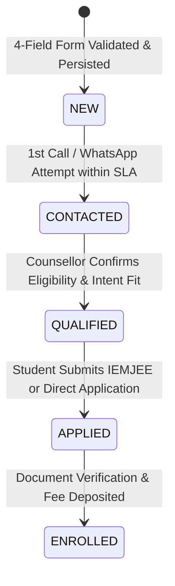

# CRM STAGE MAPPING, ATTRIBUTION & OPERATIONAL SLA
Version: 1.0 (Phase 0b Deliverable)
Last Updated: 2026-09-18

---

## 1. CRM FUNNEL STAGE DEFINITIONS



| Funnel Stage | Formal Definition | System Trigger | Transition Requirement | Data Updates |
| :--- | :--- | :--- | :--- | :--- |
| **`NEW`** | Uncontacted lead. 4 input fields validated, consent logged, persisted. | Successful `/api/lead` submission with idempotency key. | Immediate system ingestion. Auto-responder triggered. | `status = "NEW"`, `assigned_counsellor_id`, `created_at` |
| **`CONTACTED`** | A human counsellor or automated verified message has reached out. | Counsellor logs call attempt or WhatsApp interaction in CRM. | 1st outreach attempt executed within SLA window. | `status = "CONTACTED"`, `first_contact_timestamp`, `attempt_count` |
| **`QUALIFIED`** | Human counsellor verified academic credentials, branch interest, and commercial feasibility. | Counsellor completes qualification checklist. | Student meets MAKAUT/AICTE eligibility and expresses serious admission intent. | `status = "QUALIFIED"`, `qualified_branch`, `qualification_notes` |
| **`APPLIED`** | Student formally registered for IEMJEE or submitted official institute application form. | Application number entered or verified against IEM portal database. | Student provides active application ID or hall ticket reference. | `status = "APPLIED"`, `application_id`, `applied_date` |
| **`ENROLLED`** | Student paid admission booking deposit, completed physical document verification at Ashram Building. | Accounts clearance or enrollment ledger sync. | Official fee receipt generated by Institute of Engineering & Management Trust. | `status = "ENROLLED"`, `enrolment_id`, `enrolled_date` |

---

## 2. INGESTION DATA MODEL (LEAD + ATTRIBUTION)

### Ingestion Payload Schema (Zod Validated)
```typescript
export interface IngestionLeadPayload {
  // 1. Core User Input Fields (Section 9.1)
  fullName: string;                    // 2–80 chars, trimmed, clean letters/spaces
  phone: string;                       // Normalized to +91XXXXXXXXXX (from /^[6-9]\d{9}$/)
  twelfthPercentage: number;           // 0.00 – 100.00, max 2 decimals
  percentageType: 'Aggregate' | 'PCM'; // Explicit modifier
  branch: string;                      // Verified branch slug

  // 2. Consent & Legal Metadata (Section 9.5)
  consentGiven: true;                  // Must be true; unchecked by default in UI
  consentTimestamp: string;            // ISO 8601 UTC timestamp of checkbox interaction
  consentVersion: string;              // e.g. "v1.0-2026-09"
  privacyPolicyUrl: string;            // "/privacy"

  // 3. Technical & Attribution Metadata (Section 9.7)
  idempotencyKey: string;              // UUIDv4 generated per client form session
  timestamp: string;                   // ISO 8601 UTC timestamp of submission
  landingPage: string;                 // URL path where user entered
  referrer: string;                    // Document referrer or direct
  sourceCtaId: string;                 // e.g. "hero-primary-cta", "fees-cta", "courses-sticky"
  eligibilityResult: 'POSSIBLY_MEETS' | 'BELOW_THRESHOLD' | 'REVIEW_REQUIRED' | 'NOT_APPLICABLE';
  
  // 4. Campaign Attribution
  utmSource?: string;                  // e.g. "google", "meta", "organic", "whatsapp"
  utmMedium?: string;                  // e.g. "cpc", "search", "social"
  utmCampaign?: string;
  utmContent?: string;
  utmTerm?: string;
}
```

---

## 3. OPERATIONAL SLA RULES

### Response Window
- **Business Hours (09:00 AM – 07:30 PM IST, Mon–Sat)**:
  - **Maximum first-contact window**: `15 minutes`.
  - **Target first-contact window**: `< 5 minutes` for high-intent requests.
- **Off-Hours & Sundays**:
  - **Maximum first-contact window**: `< 12 hours` (or by 09:30 AM next business morning).
  - Immediate transactional SMS / WhatsApp auto-acknowledgement with counsellor operating hours.

### Outreach Cadence & Attempt Rules
- **Total outreach cycle**: 3 telephone calls + 2 WhatsApp messages over 48 hours before marking `UNREACHABLE`.
  - **Attempt 1**: T+5–15 mins (Direct phone call + automated WhatsApp greeting).
  - **Attempt 2**: T+4 hours (Follow-up phone call if unanswered).
  - **Attempt 3**: T+24 hours (Morning phone call + branch curriculum PDF on WhatsApp).
  - **Attempt 4**: T+48 hours (Final check-in message).
- **Escalation Trigger**: If a `NEW` lead remains untouched for > 30 minutes during business hours, an automated alert routes to the **Admission Lead Coordinator**.

---

## 4. FAILURE HANDLING & LOCAL FALLBACK QUEUE (ZERO-LEAD-DROP)

1. **Pessimistic Ingestion**:
   - The `/api/lead` route writes incoming leads to a local, encrypted, durable fallback storage (e.g. SQLite database or append-only JSON ledger in the protected server directory).
2. **Upstream Dispatch**:
   - The route attempts asynchronous dispatch to the configured primary destination (Supabase / Webhook / CRM API).
   - If the upstream CRM returns a `5xx`, timeouts, or network errors, the lead is preserved in the local queue with `sync_status = "PENDING_RETRY"`.
3. **Automatic Background Worker**:
   - A resilient retry worker attempts exponential backoff replay (1m, 5m, 15m, 1h).
4. **Client Response**:
   - Once the local fallback store confirms persistence, the server responds with `{ success: true, leadId: "..." }`.
   - The client UI transitions to `/thank-you`.
   - Under NO circumstances is an unpersisted lead acknowledged as successful, nor is a lead discarded due to a third-party CRM outage.
