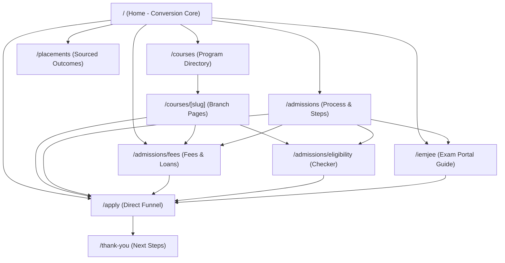

# SITEMAP & INFORMATION ARCHITECTURE — I.E.M ADMISSIONS
Version: 1.0 (Phase 0b Deliverable)
Last Updated: 2026-09-18

---

## 1. ROUTE DIRECTORY & PAGE RESPONSIBILITIES

| Route Path | Page Title | Primary Goal | Conversion Vehicle | SSR / ISR Mode | Indexing |
| :--- | :--- | :--- | :--- | :--- | :--- |
| `/` | Institute of Engineering & Management (IEM), Kolkata | High-impact institutional overview, trust establishing, branch finder | Primary 4-Field Form + Sticky Mobile CTA | SSR / ISR (3600s) | `index, follow` |
| `/courses` | B.Tech Programs & Specializations | Comprehensive directory of approved engineering streams | "Ask About This Program" CTA | SSG / ISR (86400s) | `index, follow` |
| `/courses/[slug]` | B.Tech in [Branch Display Name] | Branch curriculum, labs, faculty, intake, specific cutoffs | Program-specific 4-Field Guidance Form | SSG / ISR (86400s) | `index, follow` |
| `/admissions` | B.Tech Admission Process & Timeline | 3-Step enrollment roadmap (IEMJEE / WBJEE / Direct) | "Get Admission Guidance" Form | SSR / ISR (3600s) | `index, follow` |
| `/admissions/fees` | B.Tech Fee Structure & Bank Loans | Verified semester-by-semester fees, IOB demand letters, scholarships | "Get Fee & Scholarship Help" Form | SSR / ISR (3600s) | `index, follow` |
| `/admissions/eligibility` | Eligibility Criteria & Indication Checker | Detailed 10+2 & PCM requirements per branch | Interactive Eligibility Indication Engine | SSR | `index, follow` |
| `/iemjee` | IEMJEE 2026 Registration & Exam Guide | IEMJEE syllabus, dates, zero-fee application guide, hall tickets | "Register for IEMJEE Guidance" Form | SSR / ISR (1800s) | `index, follow` |
| `/placements` | Placement Statistics & Industry Recruiters | Sourced salary distributions, top tech recruiters, NIRF data | "Download Placement Audit Report" | SSR / ISR (86400s) | `index, follow` |
| `/campus` | Campus Facilities & Student Life | Ashram & Gurukul campus infra, central library, labs, hostels | "Schedule a Campus Visit / Guidance" | SSG | `index, follow` |
| `/resources` | Admission & Engineering Preparation Hub | Educational guides for Class 12 & entrance exams | Resource Download Gate (4 Fields) | SSG | `index, follow` |
| `/resources/[slug]` | [Guide Title] | Focused intent article (e.g. WBJEE vs IEMJEE, CSE vs IT) | Contextual in-content guidance trigger | SSG / ISR (86400s) | `index, follow` |
| `/apply` | Express B.Tech Admission Guidance | High-focus conversion landing page (distraction-free) | Centered 4-Field Lead Form | SSR | `index, follow` |
| `/thank-you` | Guidance Request Received | Post-submission confirmation, counsellor SLA, WhatsApp chat | Direct WhatsApp / Helpline next step | Client-only / SSR | `noindex, nofollow` |
| `/contact` | Official Campus Contact & Inquiries | Verified NAP, map coordinates, official helplines, operator info | Direct Click-to-Call + Office Map | SSG | `index, follow` |
| `/privacy` | Privacy Policy | DPDP-aligned data minimization & consent declaration | Privacy inquiry contact | SSG | `index, follow` |
| `/terms` | Terms of Service | User terms, intellectual property, disclaimer of guarantee | None | SSG | `index, follow` |
| `/disclaimer` | Institutional Disclaimers | Operating model disclosure (A/B/C), no guaranteed admission | None | SSG | `index, follow` |

---

## 2. HUB-AND-SPOKE INTERNAL LINKING MATRIX

### Linking Safeguards
- **No Orphan Pages**: Every leaf page links backward to parent hub and laterally to related decision steps (e.g. Every program page links to `/admissions/fees` and `/admissions/eligibility`).
- **Contextual Fallbacks**: Every informational section ends with a relevant next step link (e.g. After reading fee details, link to loan demand letter instructions or the 4-field fee advisory form).
